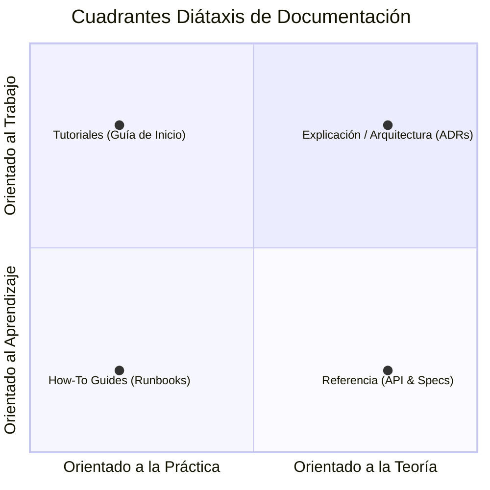

# Centro de Documentación Enterprise — Portfolio Tumidev

Bienvenido al centro de documentación oficial del proyecto. Esta documentación está organizada según el **Framework Diátaxis**, un estándar Enterprise para la arquitectura de información técnica estructurada en 4 cuadrantes.

---

## Arquitectura Diátaxis de la Documentación

---

## 📚 Mapa General de Documentación

### 1. Tutoriales (Tutorials — Aprendizaje)

- [README.md Principal](../README.md): Resumen ejecutivo, stack tecnológico y Quick Start.
- [Guía de Contribución](../CONTRIBUTING.md): Guía de incorporación para desarrolladores, flujo de Git y normas de PR.

### 2. Guías de Procedimiento (How-To Guides — Tareas Prácticas)

- [Runbook de Desarrollo Local](./guides/LOCAL_DEVELOPMENT_RUNBOOK.md): Guía para coexistencia en Windows, WSL2, Docker y pnpm.
- [Runbook de Despliegue y CI/CD](./guides/DEPLOYMENT_RUNBOOK.md): Procedimiento de despliegue en Vercel y pipelines de validación.
- [Runbook de Web Application Firewall](./guides/WAF_RUNBOOK.md): Configuración y observación del WAF de Vercel para el endpoint de contacto.

### 3. Referencia Técnica (Reference — Información Explicita)

- [Especificación del API de Contacto](./api/CONTACT_API_SPEC.md): Especificación del contrato OpenAPI 3.1 para `/api/contact`.
- [Especificaciones de Features (SDD)](../specs/): Specs spec-anchored con requisitos, criterios de aceptación y trazabilidad.
- [Política de Seguridad](../SECURITY.md): Especificaciones de CSP, HSTS, contrato Zod, escape contextual y Rate Limiting WAF.
- [Orquestador AI y Reglas de Desarrollo](../AGENTS.md): Especificación para agentes de IA y comandos del sistema (`.opencode/`).
- [Integración MCP multi-herramienta](./reference/MCP_INTEGRATION.md): Contrato compartido y adaptadores para OpenCode, VS Code y futuros harnesses.
- [Registro MCP machine-readable](./reference/mcp-registry.json): Estados, transportes, alcances y restricciones para automatización.

### 4. Explicación y Decisiones (Explanation / Architecture — Entendimiento)

- [Arquitectura del Sistema](./architecture/ARCHITECTURE.md): Diagrama C4, capas de componentes y flujo de datos.
- [Registros de Decisiones de Arquitectura (ADRs)](./adr/):
  - [ADR 0001: Next.js 16 App Router & Turbopack](./adr/0001-nextjs-app-router-turbopack.md)
  - [ADR 0002: Sistema de Colores Progresivo y Tailwind CSS v4](./adr/0002-tailwind-v4-color-system.md)
  - [ADR 0003: Migración al Gestor de Paquetes pnpm v11](./adr/0003-pnpm-package-manager.md)
  - [ADR 0004: Suite de Accesibilidad WCAG 2.1 de 4 Cuadrantes](./adr/0004-accessibility-wcag-system.md)
  - [ADR 0005: Estrategia de Actualización de Dependencias Major/Patch](./adr/0005-dependency-update-strategy.md)
  - [ADR 0006: Protección Enterprise del Edge](./adr/0006-enterprise-edge-protection.md)
  - [ADR 0007: Constitución del Proyecto (SDD)](./adr/0007-project-constitution.md)
- [Investigación de Accesibilidad de Color](./research/RESEARCH_COLOR_SYSTEM.md): Análisis de ratios de contraste WCAG 2.1.
- [Historial de Mejoras](./history/HISTORIAL_MEJORAS.md): Bitácora histórica de iteraciones y auditorías.
